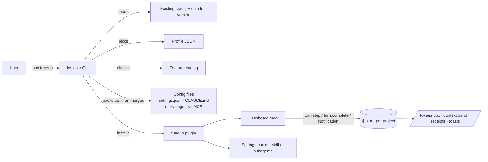

# Tuneup architecture

Tuneup has two independent parts: an **installer** that runs once and edits config files, and a **dashboard mod** that runs inside every Claude Code session and only reads events and draws. The mod can be installed on its own by people who already have a setup they like.



## 1. Installer

Distributed as an npm package so `npx tuneup` works on macOS, Linux and Windows. No .exe.

### Flow

1. **Detect** – Claude Code installed? `claude --version`. Read `~/.claude/settings.json`, project `.claude/`, `CLAUDE.md`, `AGENTS.md`. Detect OS, shell, `jq`, Git Bash.
2. **Interview** – about six questions: what they build, solo or team, API key or Pro/Max subscription, cost vs speed, services used (GitHub, database, Figma, browser).
3. **Pick a profile** – map answers to a file in `profiles/`.
4. **Resolve features** – filter `catalog/features.json` by the profile and the installed Claude Code version.
5. **Preview** – show a diff of every file to be created or changed, plus an estimate of always-loaded context added.
6. **Back up and merge** – copy touched files to `~/.tuneup/backups/<timestamp>/`, then merge.
7. **Install the plugin** – add this repo as a marketplace and install `tuneup-dashboard@tuneup`.
8. **Verify** – run `claude plugin validate`; suggest `/doctor` in the first session.

### Commands

| Command | Does |
| --- | --- |
| `npx tuneup` | Full flow above. `--profile <id>`, `--dry-run` (stop after the preview), `--yes`, `--marketplace <source>` |
| `npx tuneup undo` | Restore this project's most recent backup |
| `npx tuneup update` | Re-check the catalog against the installed version, offer new features |
| `npx tuneup report` | Print token totals from the mod's saved data |

### Merge rules

- **JSON settings:** deep-merge keys. Never delete user keys. Arrays (e.g. permission allow rules) are unioned.
- **CLAUDE.md:** write only between `<!-- tuneup:start -->` and `<!-- tuneup:end -->`. If the repo already uses `AGENTS.md` and has no `CLAUDE.md`, don't create a duplicate.
- **Scope:** the installer writes only inside the project it runs in (`.claude/settings.json`, `CLAUDE.md`) and installs the plugin at project scope. `~/.claude` is read, never written; backups go to `~/.tuneup/backups/` (`TUNEUP_HOME` moves it).
- **Formatting:** a settings file that already holds every key is left byte for byte as it is.
- **Every run writes a manifest** of what changed, before the first write. `undo` uses it to restore files byte for byte, delete files the run created, uninstall the plugin and remove a marketplace the run registered. A file edited after the run is copied to `before-undo/` in the backup first.

## 2. What the installer configures

| Piece | Writes | Why |
| --- | --- | --- |
| Settings | Default model and effort per profile, allow rules for safe commands, prompt cache TTL | Fewer permission stops, cheaper defaults |
| CLAUDE.md | Short template, ~60 line cap | Less always-loaded context |
| Path rules | `.claude/rules/*.md` with `paths:` frontmatter | Instructions load only when relevant |
| MCP servers | Only the ones the user picked, project-scoped | Each server's tools cost context every request |
| Subagents | Researcher + test runner on a cheaper model | Heavy reading stays out of the main context |
| Skills | 2–3 small skills | Full text loads only when used |
| Settings hooks | `SessionStart` stale-resume warning using `context_tokens` and `estimated_cache_write_usd` | Warns before an expensive uncached resume |
| Status line | Model, context %, session cost | Fallback where mods can't draw |

## 3. Dashboard mod

A Claude Code mod (plugin with JS/TS function hooks). Requires Claude Code v2.1.287+ in the terminal or v2.1.286+ in the Desktop app.

### Files

```text
plugins/tuneup-dashboard/
├── .claude-plugin/plugin.json   # names the state contract: "types": "./types/index.d.ts"
├── hooks/hooks.json             # { "modules": ["./register.tsx"] }, loaded as-is, no build step
├── hooks/register.tsx           # hook wiring
├── hooks/totals.ts · format.ts  # pure helpers
├── hooks/rates.ts               # API list prices per model, with the date they were checked
├── types/index.d.ts             # $.state declarations
└── tests/*.test.ts              # claude plugin test
```

### Events used

| Event | Used for |
| --- | --- |
| `session.start` | Register `/tokens` command, load saved totals (a `$.state` write redraws its readers, so no timer) |
| `classic.SessionStart` (`clear`, `resume`, `fork`) | Reload totals into `$.state` after resets |
| `turn.step` | Async generator hook. Price each request from `hooks/rates.ts` by `result.usage.model`. Read `result.usage` (`input_tokens`, `output_tokens`, `cache_read_input_tokens`, `cache_creation_input_tokens`; may be `null`) per request; split by `e.agentId` |
| `turn.complete` | `durationMs` for the turn receipt, with the tokens summed from that turn's own `turn.step` requests so the receipt and the box count the same thing, returned as `{ text }` (shown under the answer, not recorded in the transcript). Also fires for subagent runs: no receipt when `e.agentId` is set. Saves to `$.store` |
| `session.end` | Save anything not yet written |
| `classic.Notification` (`permission_prompt`, `idle_prompt`) | Start the "Claude waited for you" clock |
| `prompt.submit` / `tool.check` resolving | Stop the waiting clock |
| `command.run` (`tokens`) | Show or hide the box above the prompt and return `{}`: a command's `text` is read by the model, so text is returned only where nothing can draw |
| `ui.render` (`AbovePrompt`) | Draw the token box in the band above the prompt, when `/tokens` has turned it on; pass to `next(e)` otherwise and while a survey holds the band |

### State

| Where | What |
| --- | --- |
| Module variables | Usage not yet saved, waiting-clock start time |
| `$.state` | Current session totals, loaded project and all-project totals, active tab, whether the box is shown (survive module reload, redraw automatically) |
| `$.store` | Per-project totals and daily history, keyed `project:<path>` and `day:<project>:<yyyy-mm-dd>`, where the path is `$.session.root()` |

Each session's totals are also saved under `session:<startedAt>`, where `startedAt` is `$.session.usage().startedAt`, and read back at `session.start` and on resume. The Desktop app resumes a conversation in a new process with a new session id (seen 2026-10-11: one chat, two transcript files), which empties `$.state`; the start time is the one value documented to carry over a resume and to start over on `/clear`. The newest 50 saved sessions are kept.

Write each project/day under its own key and re-read before writing, because several sessions share one store.

### What the user sees

- **`/tokens` box** – a small bordered card above the prompt, shown and hidden by `/tokens`. Tabs: This session · This project · All projects. Four headline figures (total tokens, share from cache, API-equivalent cost, turns), then the breakdown by token type and the subagent share. The cache share is green from 50% and yellow below.
- **Sparkline** – tokens per day, last 14 days (`Raster`, terminal only; text in Desktop).
- **Context band** above the prompt – context bar and a `/compact` hint past a threshold.
- **Turn receipt** – "✓ Done in 42s  ·  18.4k tokens  ·  71% from cache  ·  $0.12". The cost is left off when the model has no known rates.
- **Toasts** – daily budget thresholds the user set.

### Constraints

- Read-only: no network, no file writes outside `$.store`, never adds to Claude's context.
- Show the box only when `/tokens` asks for it. It is drawn in the band above the prompt, not a pane, so it has no width floor; Claude Code adds its own collapse mark beside it.
- VS Code chat panel and `claude -p` run hooks but don't draw; fall back to the status line and receipt text.
- **Turn receipt by surface** (checked 2026-10-11 on Claude Code 2.1.296):
  - *Terminal:* the `{ text }` a `turn.complete` hook returns is drawn under the answer, next to the line that closes the turn.
  - *Desktop app:* that text is not shown. This was observed in the Code tab; the docs don't state it. The API types give the likely reason: the turn-closing line (`TurnDuration`) is raised on the terminal only, and "a remote surface draws its own footer".
  - *Fallback:* when `$.session.surfaces()` has `desktop` and no `terminal`, the mod sends the receipt with `$.ui.log`, a dim transcript line that is not sent to the model, and returns the answer unchanged. `turn.complete` has no `e.surface`, so the session's surfaces decide.
- Each headline figure is a `Box` of fixed width. Never pad labels with spaces: the Desktop app's font is proportional.
- Dollar figures are labeled "API-equivalent"; subscriptions aren't billed per token. They price all four token types from `hooks/rates.ts`, at the 5-minute cache write price. A model with no row there shows "—", and totals that mix priced and unpriced tokens are marked "(partial)".
- "From cache" has one definition everywhere: `cache_read / (input + cache_read + cache_write)`.

## 4. Feature catalog

`catalog/features.json`, one entry per feature:

```json
{
  "id": "dashboard-mod",
  "minVersion": "2.1.287",
  "profiles": ["*"],
  "install": { "plugin": "tuneup-dashboard@tuneup" },
  "why": "Token box and waiting timer inside Claude Code"
}
```

`install` is one of `{ "plugin": "<name>@<marketplace>" }`, `{ "settings": { ... } }` (merged into `settings.json`) or `{ "claudeMd": "templates/<file>" }` (written between the tuneup markers).

A weekly GitHub Action diffs the official Claude Code changelog and opens an issue per new feature; a maintainer decides whether it enters a profile.

## 5. Profiles

`profiles/<name>.json` selects catalog entries and template variables. `settings` holds real `settings.json` keys and is merged as written:

```json
{
  "id": "web-solo-budget",
  "match": { "stack": "web", "team": false, "priority": "cost" },
  "title": "Web, solo, lowest cost",
  "features": ["dashboard-mod", "lean-claude-md", "safe-allow-rules"],
  "settings": { "model": "sonnet", "effortLevel": "medium" },
  "mcp": []
}
```

## 6. Repo layout

```text
tuneup/
├── installer/
├── catalog/features.json
├── profiles/
├── templates/
├── plugins/tuneup-dashboard/
├── .claude-plugin/marketplace.json
├── .github/workflows/
├── CLAUDE.md
└── architecture.md
```

## 7. Roadmap

| Phase | Scope | Gate to next |
| --- | --- | --- |
| MVP | Dashboard mod (`/tokens` box, turn receipts), installer with 2 profiles, backup/preview/undo | 10 testers use it for a week with no broken configs |
| v1 | Interview + 6 profiles, waiting timer, context band, sparkline, catalog + `update` | Catalog CI passes on the latest Claude Code release |
| v2 | Team profiles, `report` with CSV export, community profile PRs, changelog bot | — |

## 8. Decisions

| Decision | Reason |
| --- | --- |
| npm/npx, not .exe | Cross-platform, inspectable, no antivirus flags |
| Right-sized, not "enable everything" | Every MCP server and always-loaded file costs tokens per request |
| Mod separate from installer | Mod is low-risk and useful alone; ship it first |
| TypeScript everywhere | One language for contributors |
| Repo is its own marketplace | `claude plugin install` works without npm |
